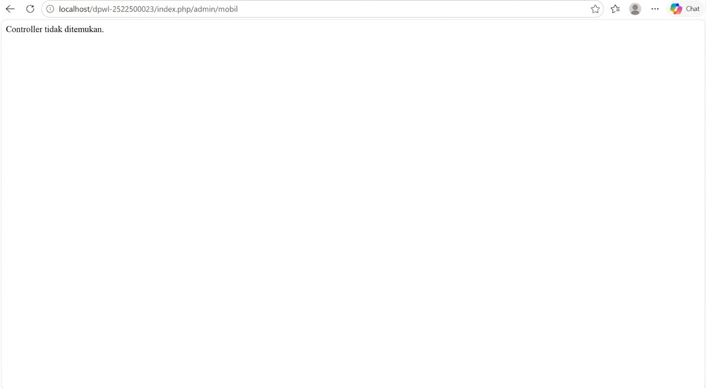
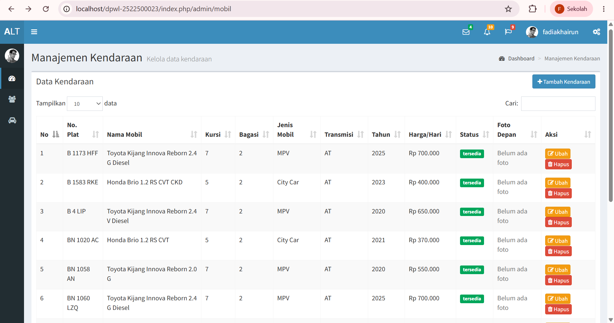
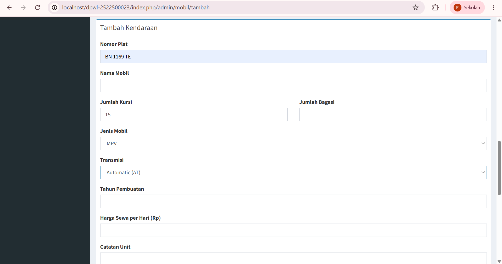
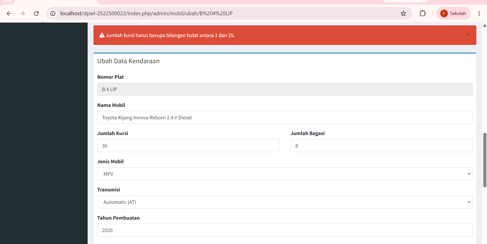
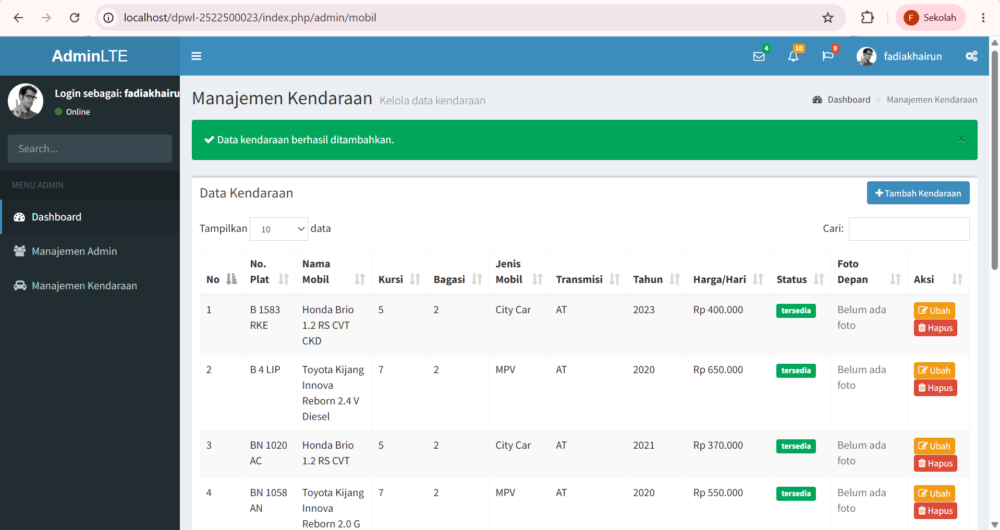
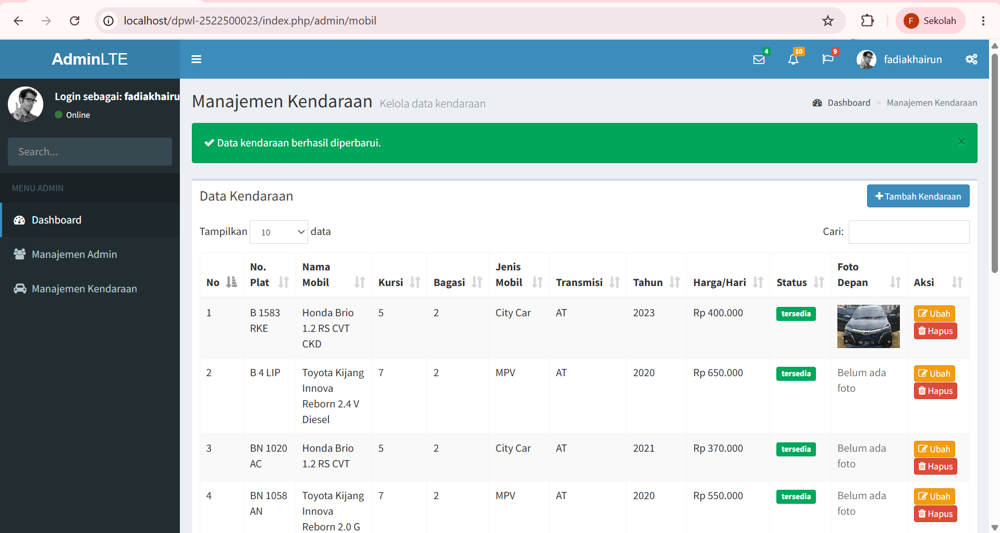
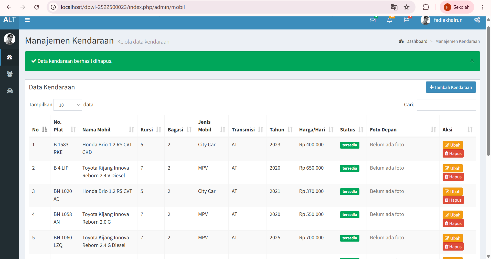

# pertemuan-05
# Catatan Perkembangan Pertemuan 05 - Tahap A
- Ringkasan Perubahan
Pada tahap ini, dilakukan pengujian tampilan dan navigasi menu untuk fitur Manajemen Kendaraan.
- File yang Diubah
* `application/views/templates/sidebar.php` (Menambahkan menu Manajemen Kendaraan)[cite: 3]
* `application/config/routes.php` (Menambahkan konfigurasi route `admin/mobil`)[cite: 3]
- Hasil Pengujian
Saat menu **Manajemen Kendaraan** diklik, URL berhasil mengarah ke `localhost/.../index.php/admin/mobil`[cite: 3]. Halaman menampilkan pesan:
> **Controller tidak ditemukan.**
**Penjelasan:** 
Pesan tersebut merupakan kondisi yang diharapkan pada tahap A.4[cite: 3]. Hal ini membuktikan bahwa konfigurasi *route* dan tautan menu di *sidebar* sudah berjalan dengan benar, namun file `Mobil_controller.php` memang belum dibuat pada folder `application/controllers/`

# Catatan Perkembangan Pertemuan 05 - Tahap B
- Ringkasan Perubahan
Pada tahap ini, dilakukan penambahan konfigurasi route baru untuk mendukung fungsi CRUD (tambah, ubah, dan hapus) kendaraan pada Manajemen Kendaraan[cite: 4].
-  File yang Diubah
* `application/config/routes.php` (Menambahkan 3 route baru untuk proses CRUD kendaraan)[cite: 4]
- Penambahan Route Baru
* `admin/madmin/tambah` -> `madmin_controller/tambah`
* `admin/madmin/ubah/(:any)` -> `madmin_controller/ubah/$1`
* `admin/madmin/hapus/(:any)` -> `madmin_controller/hapus/$1`

- Hasil Pengujian Route (Tahap B.2)
Saat URL `admin/mobil` diakses, halaman masih menampilkan pesan:
> **Controller tidak ditemukan.**
**Penjelasan:**
Pesan error ini masih merupakan kondisi yang diharapkan pada tahap B.2 karena file `Mobil_controller.php` belum dibuat[cite: 4]. Pengujian fungsi lengkap untuk setiap route baru akan dilakukan setelah Controller diimplementasikan pada Tahap C[cite: 4].

# Catatan Perkembangan Pertemuan 05 - Tahap C
- Ringkasan Perubahan
Pada tahap ini, dilakukan implementasi fitur READ data kendaraan menggunakan arsitektur MVC (Model-View-Controller) untuk menampilkan daftar kendaraan dari tabel `t_mobil`[cite: 4, 8].
- Berkas yang Ditambahkan dan Diubah
* `application/models/Mobil_model.php` (Model baru untuk mengambil data dari tabel `t_mobil` melalui method `getAll()`)[cite: 5, 8]
* `application/controllers/Mobil_controller.php` (Controller baru untuk menangani logika alur data dan pemanggilan view)[cite: 5, 8]
* `application/views/admin/mobil_view.php` (View baru untuk menampilkan antarmuka tabel daftar kendaraan)[cite: 5, 8]
- Alur READ yang Diimplementasikan
1. Pengguna mengakses URL `admin/mobil` pada browser[cite: 5].
2. System Router mengarahkan permintaan ke `Mobil_controller` pada method `index()`[cite: 5].
3. Controller menjalankan pemeriksaan sesi admin (`require_admin_login()`) lalu memanggil `Mobil_model` melalui method `getAll()`[cite: 5].
4. Model membaca dan mengambil seluruh record data dari tabel database `t_mobil`[cite: 5].
5. Controller meneruskan data hasil pembacaan tersebut ke View `admin/mobil_view` untuk ditampilkan dalam bentuk tabel HTML[cite: 5].
- Hasil Pengujian Aktual
Saat halaman `localhost/.../index.php/admin/mobil` diakses, halaman berhasil memuat antarmuka **Manajemen Kendaraan** dan menampilkan daftar data kendaraan secara lengkap tanpa adanya pesan kesalahan (*error*)[cite: 4, 8].

# Catatan Perkembangan Pertemuan 05 - Tahap D
- Ringkasan Perubahan
Pada tahap ini, dilakukan implementasi fitur INSERT (Tambah Data Kendaraan) lengkap dengan validasi input, fitur unggah foto, dan umpan balik pesan kesalahan/keberhasilan[cite: 16]
- Berkas yang Diubah
* `application/models/Mobil_model.php` (Menambahkan method `create()` untuk menyimpan data kendaraan ke tabel `t_mobil`)[cite: 8, 16]
* `application/controllers/Mobil_controller.php` (Menambahkan method `tambah()`, `renderMobil()`, `validateMobilInput()`, `uploadFoto()`, dan `hapusFotoBaru()`)[cite: 10, 16]
* `application/views/admin/mobil_view.php` (Menambahkan antarmuka formulir tambah kendaraan dan penangan pratinjau foto via JavaScript)[cite: 15, 16]
- Fitur dan Alur INSERT yang Diimplementasikan
1. **Formulir Tambah Kendaraan:** Menampilkan bidang input data kendaraan lengkap beserta upload foto kendaraan (depan, belakang, interior)[cite: 15].
2. **Validasi Input:** Memeriksa tipe data, kelengkapan input, batas panjang karakter, serta batas nilai numerik sebelum data diproses[cite: 13, 16].
3. **Unggah Foto:** Memproses berkas foto bertipe JPG/PNG/WEBP dengan batas ukuran maksimal 5 MB dan menyimpan nama berkas secara terenkripsi ke folder `uploads/mobil/`[cite: 14, 16].
4. **Pola PRG (Post/Redirect/Get):** Jika berhasil, aplikasi mengalihkan halaman kembali ke daftar kendaraan dengan pesan *flash success*. Jika gagal, foto baru yang terunggah dibersihkan dari penyimpanan dan formulir menampilkan pesan kesalahan[cite: 10, 16].
- Hasil Pengujian Aktual
* **Uji Input Valid:** Berhasil menambahkan data kendaraan baru ke database dan foto tersimpan di folder target[cite: 16]. Halaman mengarah ke `admin/mobil` dengan pemberitahuan sukses.
* **Uji Validasi Error:** Menguji input yang tidak valid (misal: nomor plat kosong/foto terlalu besar), sistem berhasil menolak penyimpanan, menghapus foto yang terunggah sebagian, dan menampilkan pesan peringatan di halaman formulir[cite: 16].

## DOKUMENTASI HASIL PENGUJIAN
1. Hasil Pengujian 1

2. Hasil Pengujiann 2

3. Hasil Pengujian 3

4. Hasil Pengujian 4

5. Hasil Pengujian 5

6. Hasil Pengujian 6

7. Hasil Pengujian 7

8. Hasil Pengujian 8
