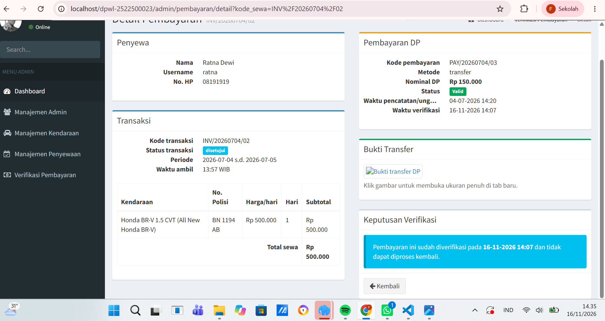
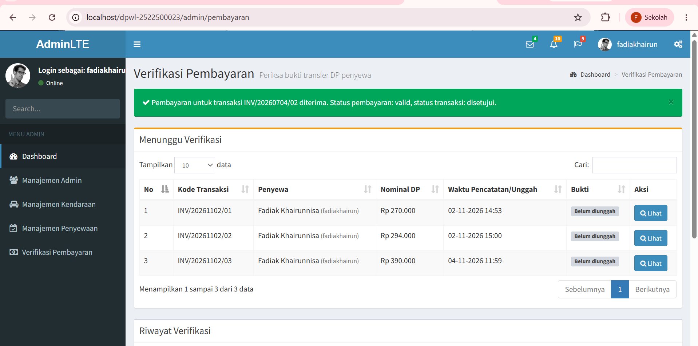
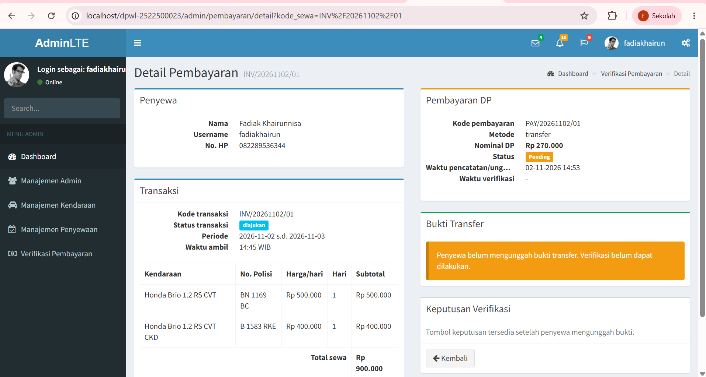
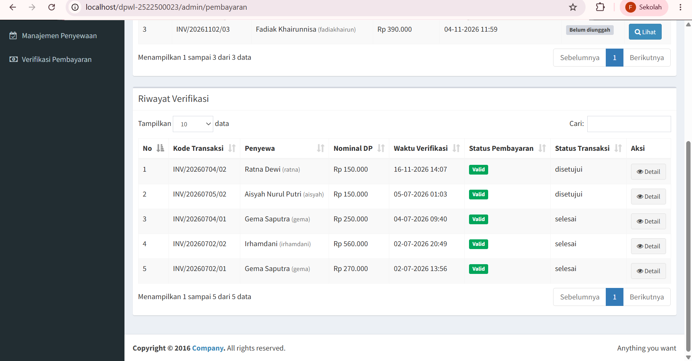
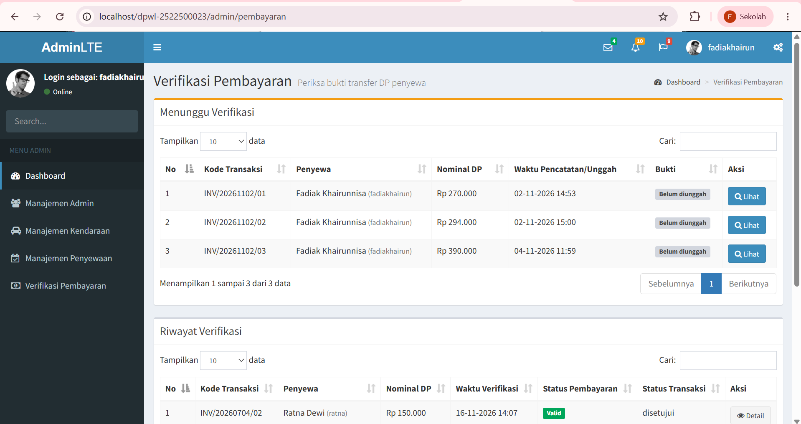

# pertemuan-09
# Praktikum Mandiri P9 - Pembayaran Awal dan Verifikasi Pembayaran

Lanjutan aplikasi Sistem Informasi Penyewaan Kendaraan (PHP 8.4, homemade MVC, MySQLi) dari P7.
Tidak ada aplikasi baru; fitur P7 dipertahankan.

## Fitur yang ditambahkan
- **Penyewa**: halaman `pembayaran` (daftar) dan `pembayaran/detail?kode_sewa=...` (rincian transaksi, DP 30%, unggah bukti transfer).
- **Admin**: menu *Verifikasi Pembayaran* (`admin/pembayaran`), detail + bukti (`admin/pembayaran/detail?kode_sewa=...`), terima/tolak (`admin/pembayaran/verifikasi`, POST).
- Unggah memperbarui record DP yang sudah dibuat saat checkout (tidak ada INSERT baru ke `t_bayar`).

## Berkas baru
| Berkas | Peran |
|---|---|
| `application/models/Pembayaran_model.php` | Akses data `t_bayar`/`t_sewa` (prepared statement, transaksi DB) |
| `application/controllers/Pembayaran_controller.php` | Penyewa: autentikasi, kepemilikan, validasi & penyimpanan berkas, PRG |
| `application/controllers/Verifikasi_controller.php` | Admin: pengendalian akses, keputusan terima/tolak, PRG |
| `application/views/pembayaran/daftar.php`, `detail.php` | Tampilan penyewa |
| `application/views/admin/verifikasi_view.php`, `verifikasi_detail.php` | Tampilan admin |
| `uploads/bayar/.htaccess` (opsional) | Larang eksekusi skrip di folder bukti |
| `sql/cek_p9.sql` | Pengecekan struktur database sebelum uji |

## Berkas yang diubah
| Berkas | Perubahan |
|---|---|
| `application/config/routes.php` | + 6 route P9 |
| `application/controllers/Transaksi_controller.php` | Setelah checkout berhasil, redirect ke `pembayaran/detail` (sebelumnya ke katalog) |
| `application/views/templates/sidebar.php` | + menu Verifikasi Pembayaran |
| `application/views/katalog/navbar.php` | + tautan Pembayaran untuk penyewa login |
| `application/views/transaksi/konfirmasi.php` | Teks petunjuk (tidak lagi menyebut "pada P9") |

## Cara menjalankan
1. Salin isi folder `p9/` ke folder aplikasi (`C:\laragon\www\dpwl-2522500023\`), timpa berkas yang berubah.
2. Jalankan `sql/cek_p9.sql` dan pastikan syarat ENUM/kolom terpenuhi.
3. Login penyewa -> checkout -> otomatis masuk halaman pembayaran -> unggah bukti.
4. Login admin -> *Verifikasi Pembayaran* -> periksa bukti -> terima/tolak.

## Hasil pengujian (isi saat menguji)
| No | Skenario | Hasil diharapkan | Hasil aktual | OK? |
|---|---|---|---|---|
| 1 | Penyewa membuka halaman pembayaran setelah checkout | Informasi transaksi dan DP ditampilkan | | |
| 2 | Penyewa membuka pembayaran milik akun lain | Akses ditolak (403) | | |
| 3 | Unggah bukti valid (JPG/PNG/WEBP <= 2 MB) | Berkas tersimpan di `uploads/bayar/`, `ft_byr` dan `tgl_wkt_byr` diperbarui | | |
| 4 | Unggah jenis tidak diizinkan (mis. .pdf, .php, atau teks bernama .jpg) | Ditolak | | |
| 5 | Unggah berkas > 2 MB | Ditolak | | |
| 6 | Kirim formulir tanpa memilih berkas | Pesan kesalahan | | |
| 7 | Lihat pembayaran setelah unggah | Status tetap pending | | |
| 8 | Admin membuka daftar verifikasi | Pembayaran pending tampil | | |
| 9 | Admin melihat bukti transfer | Gambar dapat dibuka | | |
| 10 | Admin menerima | `sttus_byr`=valid, `status_sewa`=disetujui, `tgl_wkt_ver` terisi | | |
| 11 | Admin menolak | `sttus_byr`=invalid, `status_sewa`=ditolak, `tgl_wkt_ver` terisi | | |
| 12 | Admin memverifikasi tanpa bukti | Ditolak sistem | | |
| 13 | Admin memverifikasi pembayaran yang sudah diproses | Ditolak sistem | | |
| 14 | Penyewa membuka `admin/pembayaran` | 403 | | |
| 15 | Pengguna belum login membuka halaman pembayaran | Diarahkan ke login | | |

## DOKUMENTASI HASIL PENGUJIAN
1. Hasil Pengujian 1

2. Hasil Pengujiann 2

3. Hasil Pengujian 3

4. Hasil Pengujian 4

5. Hasil Pengujian 5

