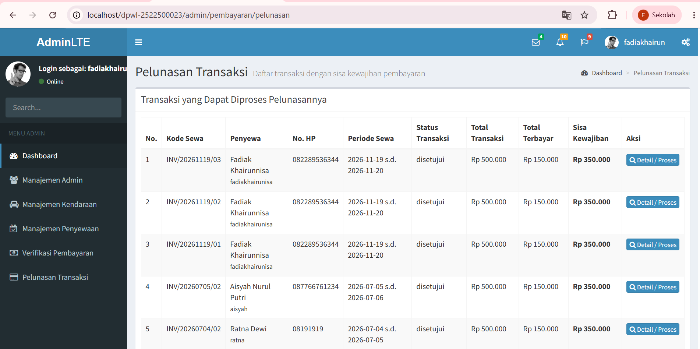
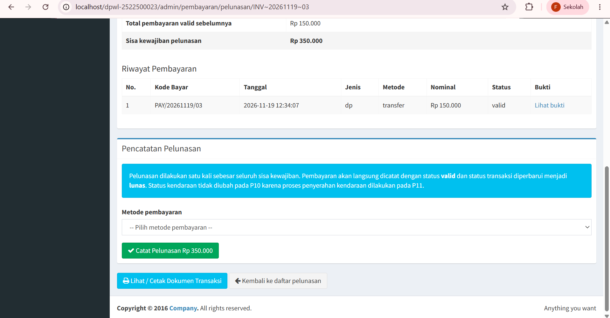
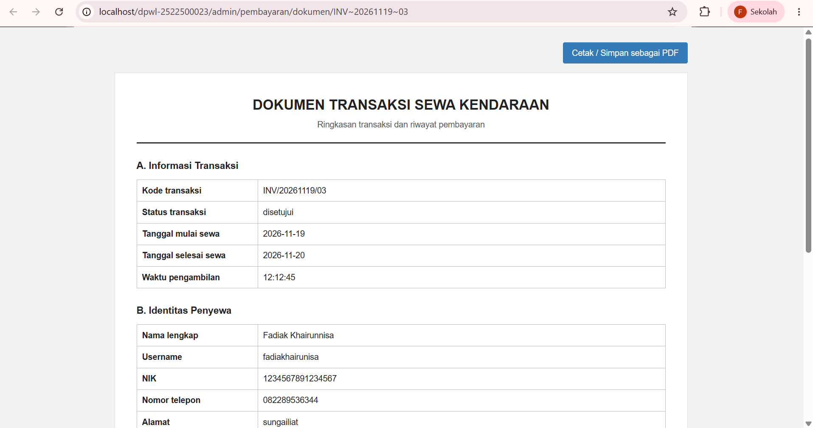

##pertemuan-10
Pelunasan dan Dokumen Transaksi

## Kondisi awal P9
Aplikasi P9 (checkout, unggah bukti DP, verifikasi admin) menjadi baseline. Catat hasil uji fitur

## Perubahan basis data
```sql
ALTER TABLE `t_sewa` CHANGE `status_sewa` `status_sewa`
ENUM('diajukan','disetujui','ditolak','aktif','selesai','batal','keranjang','lunas')
CHARACTER SET utf8mb4 COLLATE utf8mb4_unicode_520_ci NULL DEFAULT 'keranjang';
```

## Berkas ditambah / diubah
| Berkas | Perubahan |
|---|---|
| application/models/Pembayaran_model.php | + getDaftarPelunasan, getDetailPelunasan, buatKodeBayarPelunasan, simpanPelunasan |
| application/controllers/Pembayaran_controller.php | + pelunasanIndex, pelunasanDetail, prosesPelunasan, dokumenTransaksi; simpanBerkas() menerima batas ukuran opsional |
| application/config/routes.php | + 4 route P10 |
| application/views/templates/sidebar.php | + menu Pelunasan Transaksi |
| application/views/admin/pelunasan.php | baru |
| application/views/admin/pelunasan_detail.php | baru |
| application/views/admin/dokumen_transaksi.php | baru |

## Penyesuaian terhadap kode P9
- Admin P9 ada di `Verifikasi_controller`; method P10 tetap ditaruh di `Pembayaran_controller` sesuai modul dan memakai `require_admin_login()`.
- Helper modul (`simpanFileBukti`, `hapusBuktiBaru`, `redirectDenganPesan`) dibuat sebagai pembungkus helper P9 (`simpanBerkas`, `hapusBerkas`, `redirectPesan`). Batas unggah DP penyewa tetap 2 MB; bukti pelunasan 5 MB.
- Aturan bisnis di model melempar `PembayaranException` agar pesannya tampil jelas ke admin.

## Hasil pengujian
(Isi hasil uji aktual Anda: tunai, transfer, tanpa bukti, metode tidak valid, pelunasan ganda, cetak PDF, dst.)

##DOKUMENTASI HASIL PENGUJIAN
1. Hasil Pengujian 1

2. Hasil Pengujian 2

3. Hasil Pengujian 3
